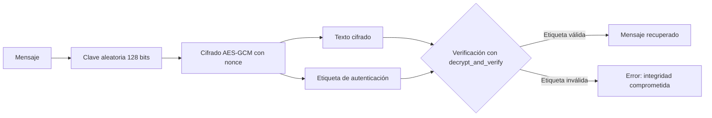

# Auditoría y mejora de cifrado AES

**Maestría en Inteligencia Artificial · Universidad Politécnica Metropolitana del Estado de Hidalgo (UPMH)**
**Asignatura:** Ciberseguridad · **Periodo:** 2026
**Alumna:** Jessica Melani Romero Lora · **Profesor:** Dr. Antonio Cedillo Hernández

> **Aviso de uso académico.** Esta práctica tiene fines exclusivamente académicos y educativos. Las técnicas descritas deben aplicarse únicamente en entornos aislados y autorizados.

---

## 1. Objetivo

Analizar una implementación de cifrado AES-128 en modo ECB, identificar sus vulnerabilidades de seguridad con apoyo de herramientas de inteligencia artificial y sustituirla por una implementación con AES-GCM que garantice confidencialidad e integridad.

## 2. Glosario

| Término | Definición |
|---|---|
| **AES (Advanced Encryption Standard)** | Cifrador por bloques simétrico que opera sobre bloques de 128 bits con claves de 128, 192 o 256 bits. |
| **Bloque** | Unidad fija de datos que el cifrador procesa de una sola vez (16 bytes en AES). |
| **Clave (key)** | Secreto compartido que determina la transformación de cifrado y descifrado. |
| **Entropía** | Medida de la impredecibilidad de una clave. Una clave de baja entropía puede adivinarse con pocos intentos. |
| **ECB (Electronic Codebook)** | Modo de operación que cifra cada bloque de forma independiente. Bloques iguales producen cifrados iguales. |
| **GCM (Galois/Counter Mode)** | Modo de operación que cifra con un contador y genera una etiqueta de autenticación. Proporciona confidencialidad e integridad. |
| **Nonce** | Valor usado una sola vez para cada cifrado. Nunca debe repetirse con la misma clave en GCM. |
| **Etiqueta de autenticación (tag)** | Valor calculado a partir del texto cifrado, el nonce y la clave. Permite detectar cualquier modificación. |
| **Relleno (padding)** | Bytes añadidos al mensaje para completar el último bloque. En este programa se usa PKCS#7. |
| **Base64** | Codificación que representa datos binarios como texto imprimible. No es cifrado. |
| **Confidencialidad** | Propiedad que impide que personas no autorizadas lean la información. |
| **Integridad** | Propiedad que garantiza que la información no fue modificada sin autorización. |
| **Hardcoding** | Práctica de escribir credenciales o claves directamente en el código fuente. |

## 3. Descripción técnica del sistema original

El programa `aes_ecb_original.py` realiza lo siguiente:

1. Define una clave fija de 16 bytes en el código fuente.
2. Rellena el mensaje con PKCS#7 hasta un múltiplo de 16 bytes.
3. Cifra con AES en modo ECB.
4. Codifica el resultado en Base64 para mostrarlo.
5. Descifra y elimina el relleno para recuperar el mensaje.

Aunque el programa funciona, presenta tres debilidades:

| # | Riesgo | Descripción | Impacto |
|---|---|---|---|
| R1 | Clave hardcodeada y de baja entropía | La clave `1234567890123456` está en el código y sigue un patrón predecible. | Quien tenga acceso al código, al repositorio o a un respaldo puede descifrar toda la información. |
| R2 | Modo ECB | Bloques de texto plano idénticos producen bloques cifrados idénticos. | Se revelan patrones y estructura del mensaje sin necesidad de conocer la clave. |
| R3 | Ausencia de integridad | ECB no verifica si el cifrado fue modificado. | Una alteración del texto cifrado no se detecta y puede producir datos corruptos o manipulados. |

## 4. Solución propuesta: AES-GCM

| Característica | AES-ECB (original) | AES-GCM (propuesta) |
|---|---|---|
| Confidencialidad | Parcial: filtra patrones | Completa, con nonce único |
| Integridad y autenticidad | No | Sí, mediante etiqueta de autenticación |
| Uso de nonce o IV | No | Sí |
| Generación de clave | Fija en el código | Aleatoria (`get_random_bytes`) |
| Detección de manipulación | No | Sí (`decrypt_and_verify`) |
| Recomendación actual | No recomendado | Estándar de la industria |

### Flujo de cifrado y verificación (AES-GCM)



## 5. Procedimiento de ejecución

**Entorno local (macOS):**

```bash
cd corte-02/practicas/aes-cifrado-auditoria
python3 -m venv .venv
source .venv/bin/activate
pip install pycryptodome
python aes_ecb_original.py
```

**Entorno de referencia:** Google Colab con PyCryptodome.

## 6. Resultados

| Parte | Descripción | Estado |
|---|---|---|
| 1 | Ejecución de AES-ECB original | Completada en local |
| 2 | Auditoría con IA y análisis crítico | En progreso |
| 3 | Implementación con AES-GCM | Pendiente |
| 4 | Prueba de manipulación del texto cifrado | Pendiente |
| 5 | Conclusión personal | Pendiente |

## 7. Aplicaciones en la vida real

- **Protocolos de comunicación segura (TLS/HTTPS):** AES-GCM es una de las suites de cifrado más utilizadas para proteger el tráfico web.
- **Cifrado de discos:** FileVault en macOS usa AES en modo XTS para proteger el contenido del disco.
- **Gestión de secretos:** servicios como AWS KMS, HashiCorp Vault y Azure Key Vault almacenan y rotan claves fuera del código fuente.
- **Protección de bases de datos y respaldos:** el cifrado en reposo evita la lectura de datos ante la pérdida física de un medio.

## 8. Estructura del directorio

```
aes-cifrado-auditoria/
├── .gitignore
├── readme.md
├── aes_ecb_original.py
└── aes_gcm_mejorado.py   (pendiente)
```

## 9. Consideraciones éticas

El análisis de vulnerabilidades se realiza sobre código propio de la práctica, con fines de aprendizaje. Ninguna técnica descrita debe aplicarse sobre sistemas, cuentas o datos de terceros sin autorización expresa y por escrito.
