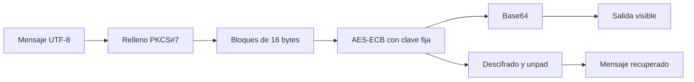
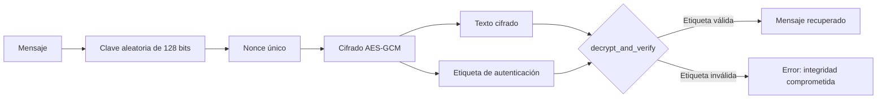
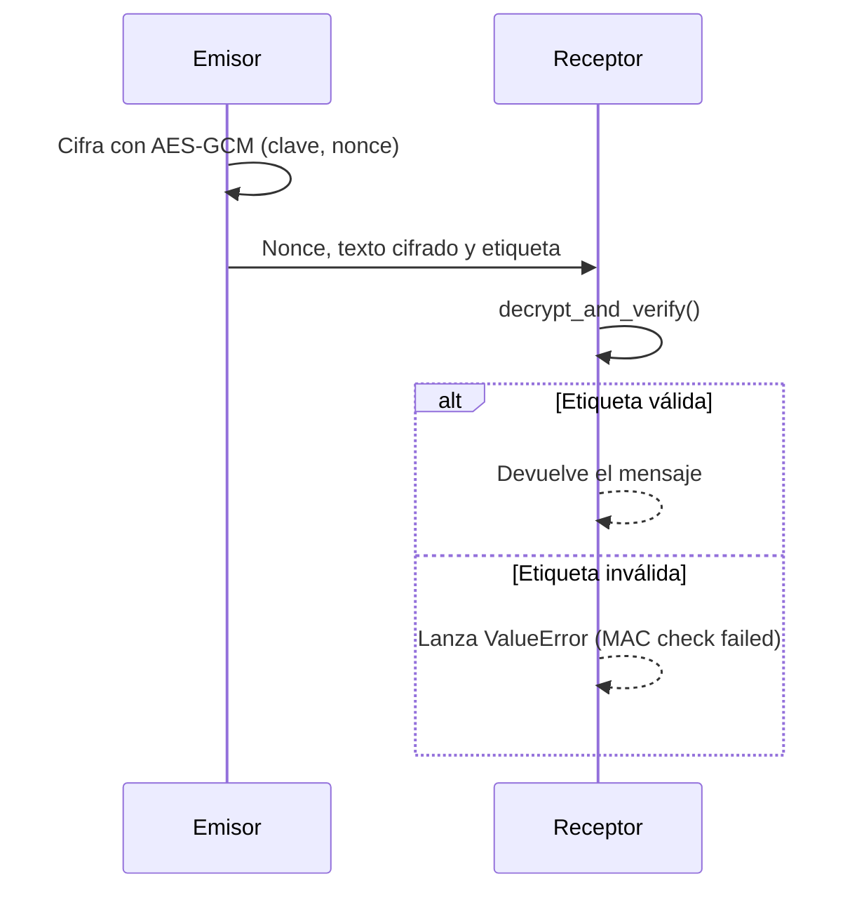

# Auditoría y mejora de cifrado AES

**Maestría en Inteligencia Artificial · Universidad Politécnica Metropolitana del Estado de Hidalgo (UPMH)**
**Asignatura:** Ciberseguridad · **Periodo:** 2026
**Alumna:** Jessica Melani Romero Lora · **Profesor:** Dr. Antonio Cedillo Hernández

> **Aviso de uso académico.** Esta práctica tiene fines exclusivamente académicos y educativos. Las técnicas descritas deben aplicarse únicamente en entornos aislados y autorizados.

---

## 1. Objetivo

Analizar una implementación de AES-128 en modo ECB, identificar sus vulnerabilidades con apoyo de herramientas de inteligencia artificial y sustituirla por una implementación con AES-GCM que garantice confidencialidad e integridad.

## 2. Marco conceptual

**AES (Advanced Encryption Standard)** es un cifrador simétrico por bloques. Procesa bloques de 128 bits (16 bytes) y admite claves de 128, 192 o 256 bits. Su seguridad depende del algoritmo, pero también del modo de operación y de la gestión de la clave.

**Modo de operación** define cómo se aplica AES a un mensaje más largo que un bloque. La elección del modo determina si se ocultan patrones, si se requiere un valor aleatorio y si se detecta una modificación.

**Confidencialidad** impide que personas no autorizadas lean la información. **Integridad** permite detectar cualquier cambio no autorizado. Un cifrado puede ofrecer lo primero sin lo segundo.

## 3. Glosario

| Término | Definición |
|---|---|
| **AES** | Cifrador simétrico por bloques de 128 bits, con claves de 128, 192 o 256 bits. |
| **Bloque** | Unidad fija de datos que AES procesa de una vez (16 bytes). |
| **Clave (key)** | Secreto que determina la transformación de cifrado y descifrado. |
| **Entropía** | Medida de la impredecibilidad de una clave. Baja entropía significa que puede adivinarse con pocos intentos. |
| **ECB (Electronic Codebook)** | Modo que cifra cada bloque de forma independiente. Bloques iguales producen cifrados iguales. |
| **GCM (Galois/Counter Mode)** | Modo que cifra con contador y genera una etiqueta de autenticación. Ofrece confidencialidad e integridad. |
| **Nonce** | Valor usado una sola vez por cifrado. En GCM no debe repetirse con la misma clave. |
| **Etiqueta de autenticación (tag)** | Valor calculado a partir del texto cifrado, el nonce y la clave. Permite detectar modificaciones. |
| **Relleno (padding)** | Bytes que completan el último bloque. Este programa usa PKCS#7. |
| **Base64** | Codificación que representa bytes como texto imprimible. No es cifrado. |
| **Hardcoding** | Escribir credenciales o claves directamente en el código fuente. |

## 4. Descripción técnica del sistema original

El archivo `aes_ecb_original.py` realiza estas operaciones:

1. Define una clave fija de 16 bytes en el código fuente.
2. Convierte el mensaje a bytes con UTF-8 y lo rellena con PKCS#7.
3. Cifra con AES en modo ECB.
4. Codifica el resultado en Base64 para mostrarlo.
5. Descifra, elimina el relleno con `unpad` y recupera el mensaje.

**Ejemplo con el mensaje de la práctica:**

| Concepto | Valor |
|---|---|
| Mensaje | `Información confidencial del cliente` |
| Longitud en bytes (UTF-8) | 37 (la "ó" ocupa 2 bytes) |
| Bytes de relleno PKCS#7 | 11 |
| Longitud tras el relleno | 48 bytes (3 bloques) |
| Longitud de la salida en Base64 | 64 caracteres |

## 5. Riesgos identificados

| # | Riesgo | Descripción | Impacto |
|---|---|---|---|
| R1 | Clave hardcodeada y de baja entropía | La clave `1234567890123456` está en el código y sigue un patrón predecible. | Quien acceda al código, al repositorio o a un respaldo puede descifrar la información. |
| R2 | Modo ECB | Bloques de texto plano idénticos producen bloques cifrados idénticos. | Se revelan patrones y estructura del mensaje sin conocer la clave. |
| R3 | Ausencia de integridad | ECB no verifica si el texto cifrado fue modificado. | Una alteración pasa desapercibida y puede producir datos corruptos o manipulados. |

## 6. Visualizaciones

### 6.1 Efecto del modo de operación sobre bloques repetidos

```
Texto plano:   [ P1 ] [ P2 ] [ P1 ]     <- bloque P1 repetido
ECB:           [ C1 ] [ C2 ] [ C1 ]     <- el patrón se conserva
GCM (nonce):   [ C1 ] [ C2 ] [ C3 ]     <- sin repeticiones visibles
```

### 6.2 Flujo del sistema original (ECB)



### 6.3 Flujo propuesto (AES-GCM)



### 6.4 Secuencia de verificación



## 7. Ejemplo demostrativo: ECB y bloques repetidos

Este ejemplo muestra el riesgo R2. Dos bloques idénticos de texto plano producen dos bloques cifrados idénticos.

```python
from Crypto.Cipher import AES

key = b"1234567890123456"
texto = b"A" * 32  # dos bloques idénticos de 16 bytes

cifrado = AES.new(key, AES.MODE_ECB).encrypt(texto)
print("Bloque 1 == Bloque 2:", cifrado[:16] == cifrado[16:])
```

**Salida esperada:** `Bloque 1 == Bloque 2: True`

## 8. Ejercicio propuesto

1. Calcula la longitud en bytes de `"Información confidencial del cliente"` usando `len(mensaje.encode())`.
2. Determina cuántos bytes de relleno PKCS#7 se agregan a ese mensaje.
3. Calcula la longitud en caracteres de la salida Base64 de 48 bytes.
4. Modifica el ejemplo de la sección 7 para usar `b"A" * 16 + b"B" * 16`. ¿Los dos bloques cifrados siguen siendo iguales? Explica por qué.

<details>
<summary>Respuestas</summary>

1. 37 bytes.
2. 11 bytes (37 + 11 = 48, múltiplo de 16).
3. 64 caracteres (48 bytes × 4/3).
4. No. Los bloques de texto plano son distintos, así que los cifrados también lo son. Esto confirma que ECB solo repite cifrados cuando los bloques de entrada se repiten.

</details>

## 9. Procedimiento de ejecución

**Entorno local (macOS):**

```bash
cd corte-02/practicas/aes-cifrado-auditoria
python3 -m venv .venv
source .venv/bin/activate
pip install pycryptodome
python aes_ecb_original.py
```

**Entorno de referencia:** Google Colab con PyCryptodome.

## 10. Comparativa de modos

| Característica | AES-ECB (original) | AES-GCM (propuesta) |
|---|---|---|
| Confidencialidad | Parcial: revela patrones | Completa con nonce único |
| Integridad y autenticidad | No | Sí, con etiqueta de autenticación |
| Nonce o IV | No | Sí |
| Generación de clave | Fija en el código | Aleatoria (`get_random_bytes`) |
| Detección de manipulación | No | Sí (`decrypt_and_verify`) |
| Recomendación actual | No recomendado | Estándar de la industria |

## 11. Estado de la práctica

| Parte | Descripción | Estado |
|---|---|---|
| 1 | Ejecución de AES-ECB original | Completada en local |
| 2 | Auditoría con IA y análisis crítico | En revisión |
| 3 | Implementación con AES-GCM | Pendiente |
| 4 | Prueba de manipulación del texto cifrado | Pendiente |
| 5 | Conclusión personal | Pendiente |

## 12. Aplicaciones en la vida real

- **Protocolos seguros (TLS/HTTPS):** AES-GCM forma parte de las suites de cifrado más usadas en la web.
- **Cifrado de discos:** FileVault en macOS utiliza AES en modo XTS para proteger el contenido del disco.
- **Gestión de secretos:** AWS KMS, HashiCorp Vault y Azure Key Vault almacenan y rotan claves fuera del código fuente.
- **Cifrado en reposo:** protege bases de datos y respaldos ante la pérdida física de un medio.

## 13. Estructura del directorio

```
aes-cifrado-auditoria/
├── .gitignore
├── readme.md
├── aes_ecb_original.py
└── aes_gcm_mejorado.py   (pendiente)
```

## 14. Aviso de autoría, privacidad y uso ético

**Autoría y derechos.** Los desarrollos, cálculos, respuestas, análisis y documentación de esta práctica son de autoría de la alumna. Los enunciados, presentaciones y archivos PDF de la asignatura son materiales del profesor y de la Universidad Politécnica Metropolitana del Estado de Hidalgo, y se incluyen únicamente con fines académicos. Queda prohibida la reproducción o distribución de los contenidos de autoría propia sin autorización expresa de la autora.

**Carácter del repositorio.** El repositorio es público porque aloja actividades académicas de posgrado de la asignatura Ciberseguridad, de la Maestría en Inteligencia Artificial. Sirve como registro de seguimiento que el profesor revisa de manera periódica. No constituye un espacio de distribución de herramientas de ataque.

**Finalidad y utilidad.** El contenido tiene fines formativos y de divulgación científica. Documenta el análisis de vulnerabilidades en implementaciones criptográficas, compara modos de operación (ECB y GCM) y fundamenta decisiones de diseño seguro. Su utilidad está en mostrar por qué un algoritmo reconocido, como AES, requiere además una gestión adecuada de claves y verificación de integridad.

**Datos y uso ético.** Los datos empleados son ficticios y no contienen información personal, confidencial ni de terceros. Las técnicas descritas deben aplicarse únicamente en entornos aislados y autorizados. Ninguna de ellas debe emplearse sobre sistemas, cuentas o datos de terceros sin autorización expresa y por escrito.
