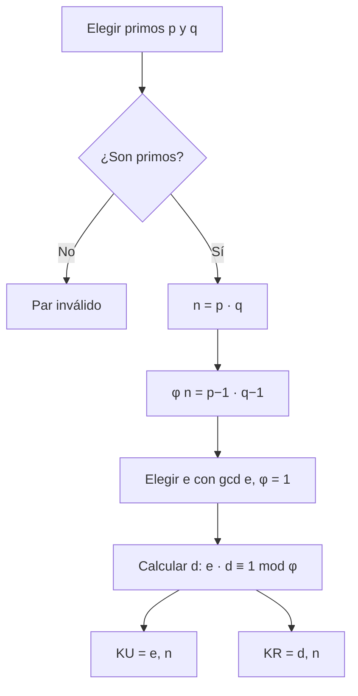
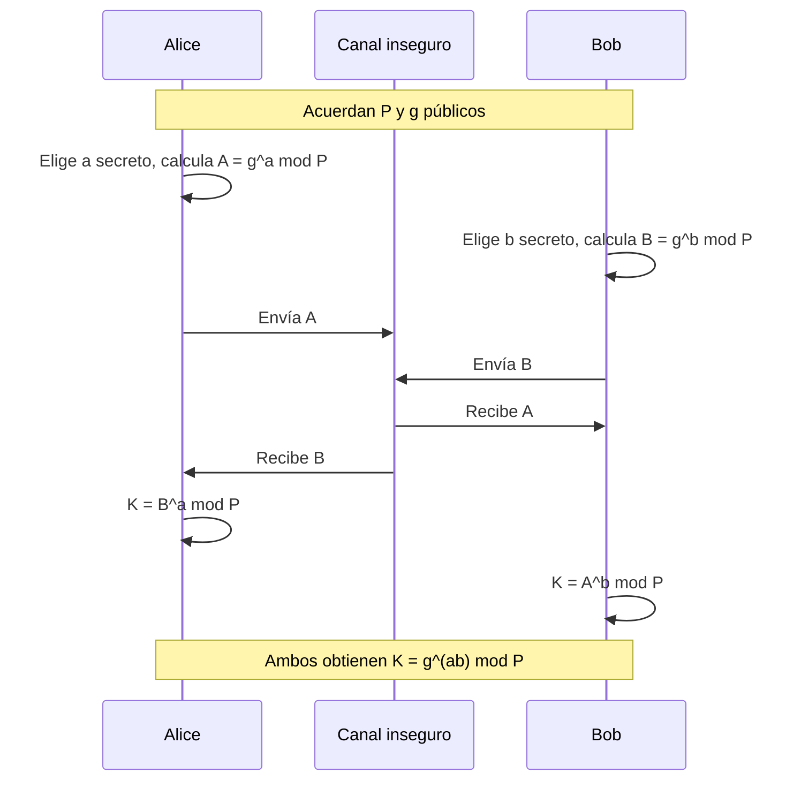
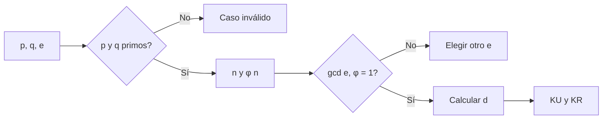
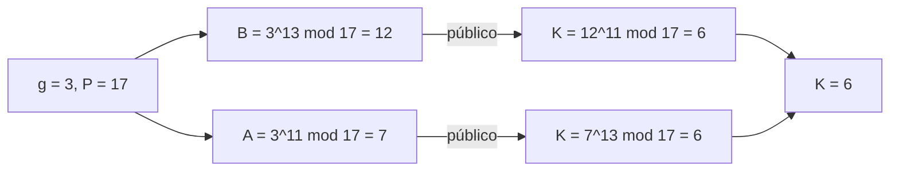
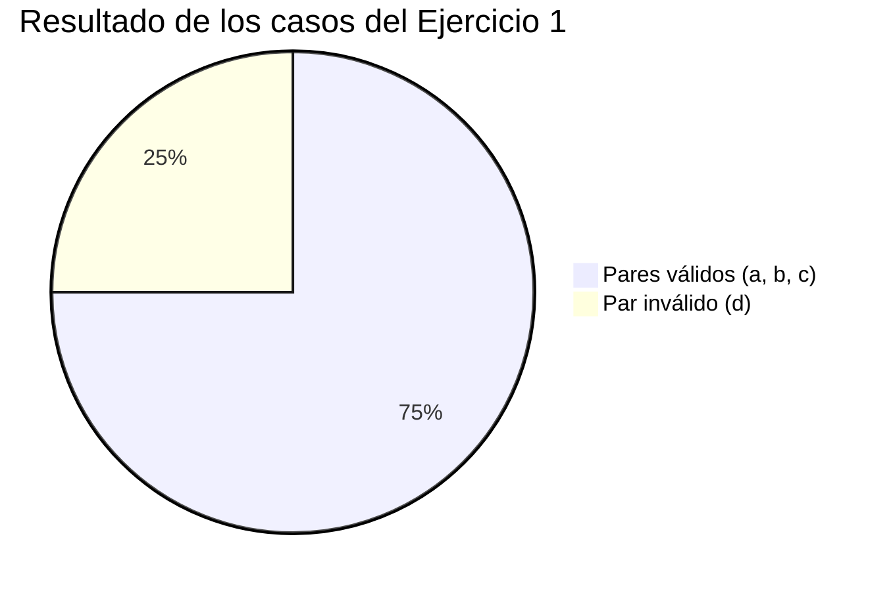

# Actividad 10: Llaves RSA y acuerdo de claves Diffie-Hellman

**Maestría en Inteligencia Artificial · Universidad Politécnica Metropolitana del Estado de Hidalgo (UPMH)**
**Asignatura:** Ciberseguridad · **Periodo:** 2026
**Alumna:** Jessica Melani Romero Lora · **Profesor:** Dr. Antonio Cedillo Hernández
**Fecha de entrega:** 30 de octubre, 23:59 (verificar en Classroom)

> **Aviso de uso académico.** Esta práctica tiene fines exclusivamente académicos y educativos. Las técnicas descritas deben aplicarse únicamente en entornos aislados y autorizados.

---

## 1. Descripción

Esta práctica aborda dos mecanismos de criptografía asimétrica. **RSA** permite cifrar y firmar mediante un par de claves pública y privada. **Diffie-Hellman** permite que dos partes acuerden una clave secreta compartida a través de un canal inseguro, sin transmitirla directamente.

## 2. Objetivos

- Calcular pares de claves RSA (KU y KR) a partir de primos *p* y *q* y de un exponente *e*.
- Identificar los valores de entrada que no son válidos para RSA y justificarlo.
- Calcular la clave secreta compartida mediante Diffie-Hellman a partir de valores privados y un primo público.

## 3. Conceptos fundamentales

**Criptografía asimétrica.** Usa dos claves relacionadas matemáticamente: una pública, que puede compartirse, y una privada, que debe mantenerse en secreto. Lo que se cifra con una se descifra con la otra.

**Número primo.** Entero mayor que 1 cuyos únicos divisores positivos son 1 y él mismo. RSA exige que *p* y *q* sean primos, porque la función φ(n) = (p − 1)(q − 1) depende de ello.

**Módulo (mod).** Resto de una división. Por ejemplo, 7⁵ mod 71 es el resto de dividir 7⁵ entre 71.

**Función φ de Euler.** Cuenta los enteros positivos menores que *n* que son primos relativos con *n*. Para *n* = p · q con p y q primos distintos, φ(n) = (p − 1)(q − 1).

**Máximo común divisor (gcd).** Mayor entero que divide a dos números. Si gcd(e, φ) = 1, *e* y φ son primos relativos, y *e* puede usarse como exponente público.

**Inverso multiplicativo.** Para *e* y un módulo φ, el inverso *d* cumple e · d ≡ 1 (mod φ). En RSA, *d* es el exponente privado.

**Raíz primitiva.** Número *g* cuyas potencias módulo *p* generan todos los enteros de 1 a *p* − 1. Diffie-Hellman la usa como base pública. Se verifica comprobando que el orden de *g* módulo *p* es *p* − 1.

**Logaritmo discreto.** Problema de encontrar *x* tal que g^x ≡ y (mod p). Calcular la potencia es rápido; invertir la operación es computacionalmente difícil para números grandes. Esa dificultad sostiene la seguridad de Diffie-Hellman.

## 4. Glosario

| Término | Definición |
|---|---|
| **KU (clave pública)** | Par (e, n) que cualquiera puede conocer para cifrar o verificar. |
| **KR (clave privada)** | Par (d, n) que solo conoce su propietario. |
| **n** | Módulo RSA: producto *p* · *q*. |
| **φ(n)** | Función de Euler: (p − 1)(q − 1) cuando n = p · q. |
| **e** | Exponente público, con gcd(e, φ(n)) = 1. |
| **d** | Exponente privado: inverso multiplicativo de *e* módulo φ(n). |
| **Primos relativos** | Dos enteros cuyo máximo común divisor es 1. |
| **Raíz primitiva** | Base *g* que genera todo el grupo multiplicativo módulo *p*. |
| **Clave secreta compartida** | Valor K que ambas partes calculan sin transmitirlo. |
| **Canal inseguro** | Medio por el que puede interceptarse la información, como internet. |

## 5. Lógica del algoritmo RSA

1. Elegir dos primos distintos *p* y *q*.
2. Calcular n = p · q.
3. Calcular φ(n) = (p − 1)(q − 1).
4. Elegir *e* tal que 1 < *e* < φ(n) y gcd(e, φ(n)) = 1.
5. Calcular *d* tal que e · d ≡ 1 (mod φ(n)).
6. Publicar KU = (e, n) y guardar en secreto KR = (d, n).

**Cifrado:** C = M^e mod n. **Descifrado:** M = C^d mod n.



## 6. Lógica del algoritmo Diffie-Hellman

1. Alice y Bob acuerdan públicamente un primo *P* y una raíz primitiva *g*.
2. Cada uno elige un valor secreto: Alice *a*, Bob *b*.
3. Alice calcula A = g^a mod P y Bob calcula B = g^b mod P.
4. Se intercambian A y B por el canal inseguro.
5. Alice calcula K = B^a mod P y Bob calcula K = A^b mod P. Ambos obtienen el mismo valor, porque B^a = g^(ab) = A^b (mod P).



## 7. Ejercicios

### Ejercicio 1: pares de claves RSA

Calcula un par de claves válido (KU y KR) para cada caso.

| Caso | p | q | e |
|---|---|---|---|
| a | 3 | 11 | 7 |
| b | 7 | 11 | 17 |
| c | 11 | 13 | 11 |
| d | 3 | 15 | 5 |

**Procedimiento general**

1. Verificar que *p* y *q* son primos.
2. Calcular n = p · q y φ(n) = (p − 1)(q − 1).
3. Verificar gcd(e, φ(n)) = 1.
4. Encontrar *d* con e · d ≡ 1 (mod φ(n)).
5. Comprobar que e · d dividido entre φ(n) deja residuo 1.



**Desarrollo por caso**

- **Caso a (p = 3, q = 11, e = 7).** n = 3 · 11 = 33. φ(n) = 2 · 10 = 20. gcd(7, 20) = 1. Buscamos *d*: 7 · 3 = 21 ≡ 1 (mod 20), por lo que d = 3. **KU = (7, 33), KR = (3, 33).**
  - Comprobación de cifrado con M = 2: C = 2⁷ mod 33 = 29. Descifrado: 29³ mod 33 = 2. El mensaje se recupera.
- **Caso b (p = 7, q = 11, e = 17).** n = 77. φ(n) = 6 · 10 = 60. gcd(17, 60) = 1. Buscamos *d*: 17 · 53 = 901 = 15 · 60 + 1, por lo que d = 53. **KU = (17, 77), KR = (53, 77).**
- **Caso c (p = 11, q = 13, e = 11).** n = 143. φ(n) = 10 · 12 = 120. gcd(11, 120) = 1. Buscamos *d*: 11 · 11 = 121 ≡ 1 (mod 120), por lo que d = 11. **KU = (11, 143), KR = (11, 143).** Aquí *d* coincide con *e*, lo cual es válido porque e² ≡ 1 (mod φ(n)).
- **Caso d (p = 3, q = 15, e = 5).** **Inválido:** 15 no es primo, así que la fórmula φ(n) = (p − 1)(q − 1) no describe correctamente el módulo. Si la aplicáramos, obtendríamos φ = 2 · 14 = 28, pero el valor real de φ(45) es 24. Con un φ incorrecto, el *d* calculado no garantiza el descifrado. Por eso el par debe rechazarse.

### Ejercicio 2: acuerdo Diffie-Hellman

Alicia y Bernardo eligen el primo P = 17. Alicia elige *a* = 11 y Bernardo *b* = 13. Determina la clave secreta compartida.

**Procedimiento**

1. Seleccionar una raíz primitiva. Usamos g = 3: sus potencias módulo 17 son 3, 9, 10, 13, 5, 15, 11, 16, 14, 8, 7, 4, 12, 2, 6, 1, de modo que el orden es 16 = P − 1.
2. Calcular las claves públicas.
   - A = 3¹¹ mod 17. Como 3⁸ ≡ 16 ≡ −1 y 3³ = 27 ≡ 10, entonces 3¹¹ ≡ (−1)(10) ≡ −10 ≡ **7**.
   - B = 3¹³ mod 17. Como 3¹³ = 3⁸ · 3⁴ · 3 ≡ (−1)(13)(3) = −39 ≡ **12**.
3. Calcular la clave compartida con cada valor privado.
   - Alicia: K = B¹¹ mod 17 = 12¹¹ mod 17 = **6**.
   - Bernardo: K = A¹³ mod 17 = 7¹³ mod 17 = **6**.

**Clave secreta compartida: K = 6.** Los dos cálculos coinciden, como predice el algoritmo.



## 8. Visualizaciones

### 8.1 Resultado de los casos RSA



### 8.2 Relación entre los componentes RSA

```
Primo p ──┐
          ├──> n = p · q ──> KU = (e, n)            (público)
Primo q ──┘        │
                   └──> φ(n) ──> d = e⁻¹ mod φ(n) ──> KR = (d, n)   (privado)
```

## 9. Aplicaciones en la vida real

- **HTTPS y certificados digitales:** RSA se usa para firmar certificados y verificar la identidad de un servidor.
- **Intercambio de claves en TLS:** Diffie-Hellman, y su variante de curva elíptica (ECDH), acuerda claves de sesión sin transmitirlas.
- **Firma digital:** RSA permite demostrar que un documento fue emitido por quien posee la clave privada.
- **Correo cifrado (PGP/OpenPGP):** usa cifrado asimétrico para intercambiar claves y cifrado simétrico para el contenido.

## 10. Estado de la práctica

| Ejercicio | Descripción | Estado |
|---|---|---|
| 1 | Pares de claves RSA (casos a a d) | Resuelto: a, b y c válidos; d rechazado y justificado |
| 2 | Clave secreta Diffie-Hellman | Resuelto y verificado: K = 6 |
| — | Revisión final y entrega en Classroom | Pendiente (verificar fecha de entrega) |

## 11. Estructura del directorio

```
rsa-diffie-hellman/
└── readme.md
```

## 12. Aviso de autoría, privacidad y uso ético

**Autoría y derechos.** Los desarrollos, cálculos, respuestas, análisis y documentación de esta práctica son de autoría de la alumna. Los enunciados, presentaciones y archivos PDF de la asignatura son materiales del profesor y de la Universidad Politécnica Metropolitana del Estado de Hidalgo, y se incluyen únicamente con fines académicos. Queda prohibida la reproducción o distribución de los contenidos de autoría propia sin autorización expresa de la autora.

**Carácter del repositorio.** El repositorio es público porque aloja actividades académicas de posgrado de la asignatura Ciberseguridad, de la Maestría en Inteligencia Artificial. Sirve como registro de seguimiento que el profesor revisa de manera periódica. No constituye un espacio de distribución de herramientas de ataque.

**Finalidad y utilidad.** El contenido tiene fines formativos y de divulgación científica. Documenta la generación de claves asimétricas y el acuerdo de claves en un canal inseguro, y fundamenta decisiones de diseño seguro. Su utilidad está en mostrar cómo se construyen los protocolos que protegen la comunicación en internet.

**Datos y uso ético.** Los datos empleados son ficticios y didácticos, con números pequeños que no ofrecen seguridad real. Los valores de producción usan primos de cientos de dígitos. Las técnicas descritas deben aplicarse únicamente en entornos aislados y autorizados. Ninguna de ellas debe emplearse sobre sistemas, cuentas o datos de terceros sin autorización expresa y por escrito.
