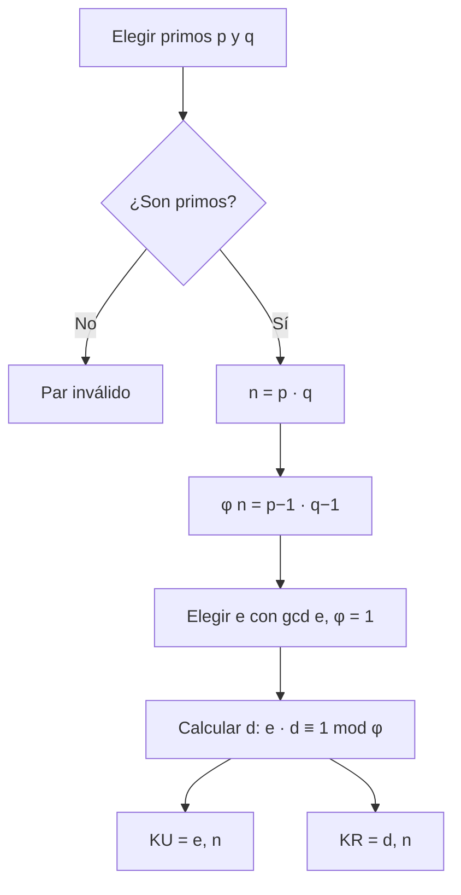
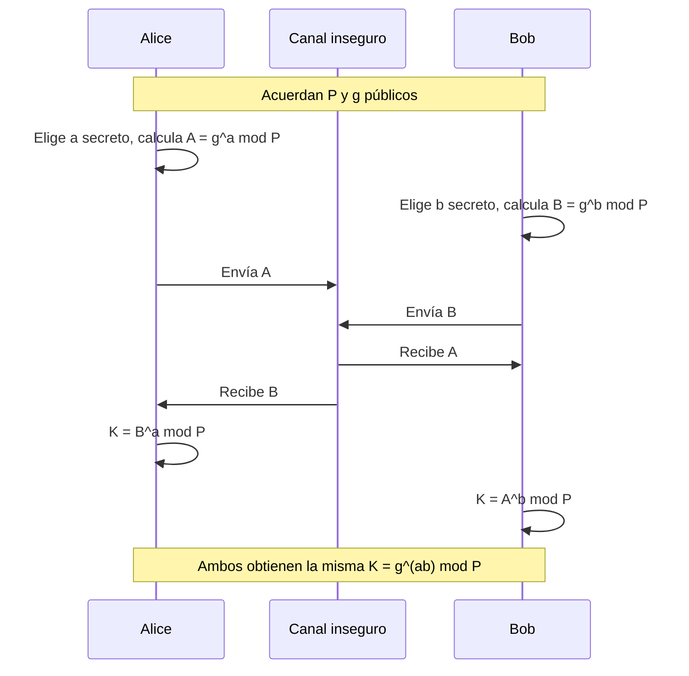
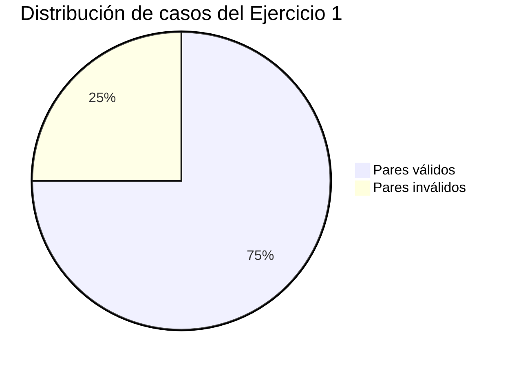

# Actividad 10: Llaves RSA y acuerdo de claves Diffie-Hellman

**Maestría en Inteligencia Artificial · Universidad Politécnica Metropolitana del Estado de Hidalgo (UPMH)**
**Asignatura:** Ciberseguridad · **Periodo:** 2026
**Alumna:** Jessica Melani Romero Lora · **Profesor:** Dr. Antonio Cedillo Hernández
**Fecha de entrega:** 30 de octubre, 23:59 (verificar en Classroom)

> **Aviso de uso académico.** Esta práctica tiene fines exclusivamente académicos y educativos. Las técnicas descritas deben aplicarse únicamente en entornos aislados y autorizados.

---

## 1. Descripción

Esta práctica aborda dos mecanismos de criptografía asimétrica. El primero, **RSA**, permite cifrar y firmar con un par de claves pública y privada. El segundo, **Diffie-Hellman**, permite que dos partes acuerden una clave secreta compartida a través de un canal inseguro, sin transmitirla directamente.

## 2. Objetivos

- Calcular pares de claves RSA (KU y KR) a partir de primos *p* y *q* y de un exponente *e*.
- Identificar qué valores de entrada no son válidos para RSA y justificarlo.
- Calcular la clave secreta compartida mediante Diffie-Hellman a partir de valores privados y público.

## 3. Conceptos fundamentales

**Criptografía asimétrica.** Usa dos claves relacionadas matemáticamente: una pública, que puede compartirse, y una privada, que debe mantenerse en secreto. Lo que se cifra con una se descifra con la otra.

**Número primo.** Entero mayor que 1 cuyos únicos divisores positivos son 1 y él mismo. RSA exige que *p* y *q* sean primos, porque la función φ(n) = (p − 1)(q − 1) depende de ello.

**Módulo (mod).** Resto de una división. Por ejemplo, 7⁵ mod 71 es el resto de dividir 7⁵ entre 71.

**Función φ de Euler (phi).** Cuenta los enteros positivos menores que *n* que son primos relativos con *n*. Para *n* = p · q con p y q primos, φ(n) = (p − 1)(q − 1).

**Máximo común divisor (gcd).** Mayor entero que divide a dos números. Si gcd(e, φ) = 1, se dice que *e* y φ son primos relativos, y *e* puede usarse como exponente público.

**Inverso multiplicativo.** Para un entero *e* y un módulo φ, el inverso *d* cumple que e · d ≡ 1 (mod φ). En RSA, *d* es el exponente privado.

**Raíz primitiva.** Número *g* cuyas potencias módulo *p* generan todos los enteros de 1 a *p* − 1. Diffie-Hellman la usa como base pública.

**Logaritmo discreto.** Problema de encontrar el exponente *x* tal que g^x ≡ y (mod p). Calcular la potencia es rápido; invertir la operación es computacionalmente difícil para números grandes. Esa dificultad sostiene la seguridad de Diffie-Hellman.

## 4. Glosario

| Término | Definición |
|---|---|
| **KU (clave pública)** | Par (e, n) que cualquiera puede conocer y usar para cifrar o verificar. |
| **KR (clave privada)** | Par (d, n) que solo conoce su propietario. |
| **n** | Módulo RSA: producto *p* · *q*. |
| **φ(n)** | Función de Euler: (p − 1)(q − 1). |
| **e** | Exponente público, con gcd(e, φ(n)) = 1. |
| **d** | Exponente privado: inverso multiplicativo de *e* módulo φ(n). |
| **Primos relativos** | Dos enteros cuyo máximo común divisor es 1. |
| **Raíz primitiva** | Base *g* que genera todo el grupo multiplicativo módulo *p*. |
| **Clave secreta compartida** | Valor K que ambas partes calculan sin transmitirlo. |
| **Canal inseguro** | Medio por el que puede interceptarse la información (por ejemplo, internet). |

## 5. Lógica del algoritmo RSA

1. Elegir dos primos distintos *p* y *q*.
2. Calcular n = p · q.
3. Calcular φ(n) = (p − 1)(q − 1).
4. Elegir *e* tal que 1 < *e* < φ(n) y gcd(e, φ(n)) = 1.
5. Calcular *d* tal que e · d ≡ 1 (mod φ(n)).
6. Publicar KU = (e, n) y guardar en secreto KR = (d, n).

**Cifrado:** C = M^e mod n. **Descifrado:** M = C^d mod n.



## 6. Lógica del algoritmo Diffie-Hellman

1. Alice y Bob acuerdan públicamente un primo *P* y una raíz primitiva *g*.
2. Cada uno elige un valor secreto: Alice *a*, Bob *b*.
3. Alice calcula A = g^a mod P y Bob calcula B = g^b mod P.
4. Se intercambian A y B por el canal inseguro.
5. Alice calcula K = B^a mod P y Bob calcula K = A^b mod P. Ambos obtienen el mismo valor.



## 7. Ejercicios

### Ejercicio 1: pares de claves RSA

Calcula un par de claves válido (KU y KR) para cada caso.

| Caso | p | q | e |
|---|---|---|---|
| a | 3 | 11 | 7 |
| b | 7 | 11 | 17 |
| c | 11 | 13 | 11 |
| d | 3 | 15 | 5 |

<details>
<summary>Solución de referencia (verificar antes de entregar)</summary>

| Caso | n | φ(n) | e | d | KU | KR | Resultado |
|---|---|---|---|---|---|---|---|
| a | 33 | 20 | 7 | 3 | (7, 33) | (3, 33) | Válido. Comprobación: 7 · 3 = 21 ≡ 1 (mod 20) |
| b | 77 | 60 | 17 | 53 | (17, 77) | (53, 77) | Válido. Comprobación: 17 · 53 = 901 ≡ 1 (mod 60) |
| c | 143 | 120 | 11 | 11 | (11, 143) | (11, 143) | Válido. Comprobación: 11 · 11 = 121 ≡ 1 (mod 120). Aquí d = e. |
| d | 45 | — | 5 | — | — | — | **Inválido**: 15 no es primo, así que φ(n) = (p − 1)(q − 1) no aplica. |

**Verificación de cifrado (caso a):** para M = 2, C = 2⁷ mod 33 = 29, y el descifrado es 29³ mod 33 = 2. El mensaje se recupera.

</details>

### Ejercicio 2: acuerdo Diffie-Hellman

Alicia y Bernardo eligen el primo P = 17. Alicia elige *a* = 11 y Bernardo *b* = 13. Determina la clave secreta compartida.

<details>
<summary>Solución de referencia (verificar antes de entregar)</summary>

**Raíz primitiva:** g = 3. Sus potencias módulo 17 generan todos los valores de 1 a 16.

| Paso | Cálculo | Resultado |
|---|---|---|
| Clave pública de Alicia | A = 3¹¹ mod 17 | 7 |
| Clave pública de Bernardo | B = 3¹³ mod 17 | 12 |
| Clave de Alicia | K = B¹¹ mod 17 = 12¹¹ mod 17 | 6 |
| Clave de Bernardo | K = A¹³ mod 17 = 7¹³ mod 17 | 6 |

**Clave secreta compartida: K = 6.** Ambos cálculos coinciden, como predice el algoritmo.

</details>

## 8. Visualizaciones

### 8.1 Comparación de los casos RSA



### 8.2 Relación entre los exponentes RSA

```
Primo p ──┐
          ├──> n = p · q ──> KU = (e, n)     (público)
Primo q ──┘        │
                   └──> φ(n) ──> d = e⁻¹ mod φ(n) ──> KR = (d, n)   (privado)
```

## 9. Aplicaciones en la vida real

- **HTTPS y certificados digitales:** RSA se usa para firmar certificados y verificar la identidad de un servidor.
- **Intercambio de claves en TLS:** Diffie-Hellman (y su variante de curva elíptica, ECDH) permite acordar claves de sesión sin transmitirlas.
- **Firma digital:** RSA permite demostrar que un documento fue emitido por quien posee la clave privada.
- **Correo cifrado (PGP/OpenPGP):** combina cifrado asimétrico para el intercambio de claves con cifrado simétrico para el contenido.

## 10. Estado de la práctica

| Ejercicio | Descripción | Estado |
|---|---|---|
| 1 | Pares de claves RSA (casos a a d) | Pendiente de procedimiento escrito |
| 2 | Clave secreta Diffie-Hellman | Pendiente de procedimiento escrito |

## 11. Estructura del directorio

```
rsa-diffie-hellman/
└── readme.md
```

## 12. Consideraciones éticasLos cálculos se realizan con números pequeños con fines didácticos. Los valores reales de RSA usan primos de cientos de dígitos. Ninguna técnica descrita debe aplicarse sobre sistemas, cuentas o datos de terceros sin autorización expresa y por escrito.
